# Automated OS Deployment Architecture (FOG Project)

Arquitectura de despliegue masivo y automatizado de sistemas operativos diseñada para entornos de soporte técnico con restricciones de red (DHCP protegido).

## 🎯 Contexto y Motivación (Problem Statement)

Actualmente, el aprovisionamiento de equipos en el taller se realiza de forma manual utilizando unidades USB multiboot (Ventoy). Este método presenta varios cuellos de botella operativos:
* **Lentitud en el despliegue:** Los tiempos de booteo e instalación están limitados por el ancho de banda del puerto y la memoria USB.
* **Falta de escalabilidad:** El formateo en simultáneo depende de la cantidad de pendrives físicos disponibles.
* **Intervención manual:** Requiere que un técnico configure parámetros iniciales equipo por equipo.

Esta solución basada en **FOG Project (PXE Boot)** nace para reemplazar las unidades USB, permitiendo el despliegue desatendido de múltiples equipos en simultáneo a través de la red LAN, reduciendo drásticamente los tiempos de instalación y la intervención manual.

## 📊 Arquitectura de Hardware y Almacenamiento

El servidor principal ha sido migrado de un entorno virtualizado a hardware físico dedicado (Intel i3, 4GB RAM) para maximizar las velocidades de despliegue. 

El almacenamiento primario (SSD 240GB) cuenta con un particionamiento optimizado para FOG:
* `/` (Raíz): 20 GB para SO y base de datos MariaDB.
* `swap`: 4 GB para respaldo de memoria durante alta concurrencia de compresión.
* `/images`: ~215 GB (Punto de montaje exclusivo) para el alojamiento principal de las Golden Images.
* `HDD 1TB` (Secundario): Destinado a almacenamiento en frío y respaldos vía Samba (WIP).

## 🕸️ Topología de Red Aislada (Network Topology)

Para evitar interferencias y colisiones con el servidor DHCP corporativo de la Universidad, se implementó una topología aislada utilizando un Router de borde físico que realiza NAT hacia la red institucional:

### 1. Router de Borde (Gigabit LAN)
* **Puerto WAN (Red Institucional):** Configurado como **Dynamic IP (DHCP Client)**. Solicita IP al servidor de la Facultad para obtener salida a internet.
* **Puertos LAN (Red del Taller):** Configurado con IP estática **`192.168.10.1`**. Actúa como Puerta de Enlace (Gateway) para el entorno aislado.
* **Servicio DHCP Interno:** **APAGADO (Disabled)** para ceder el control al servidor FOG.

### 2. Servidor FOG (Debian XFCE)
* **Interfaz Única (LAN):** Conectada a los puertos LAN del Router. 
* **IP Estática:** **`192.168.10.2/24`** configurada de forma manual (`nmtui`).
* **Gateway y DNS:** `192.168.10.1` (Para enrutamiento a través del Router).
* **Servicios Activos:** `kea-dhcp4-server` (Entrega IPs al taller, inyecta la puerta de enlace `192.168.10.1` y la orden de booteo PXE), TFTP y NFS.

### 3. Equipos Clientes (Bare Metal)
Se conectan vía Ethernet directamente a los puertos LAN del Router. Reciben su IP e instrucciones de booteo desde `192.168.10.2` y el router procesa el NAT para que salgan a Internet a través de su puerta de enlace `192.168.10.1`.

## 🚀 Componentes Clave (Key Components)

1. **Servidor FOG (Debian):** Gestión de imágenes, TFTP y almacenamiento NFS.
2. **Despliegue Desatendido:** Integración con Windows Sysprep y scripts de automatización (Batch, PowerShell) (`SetupComplete.cmd`) para la configuración dinámica de almacenamiento secundario (SSD/HDD), instalación de software adicional y activación de Windows.
3. **Aislamiento de Red:** Prevención de colisiones de DHCP corporativo.
4. **Disaster Recovery (Preservación de Datos):** Sistema automatizado de retención y autocurado que protege la partición secundaria del usuario frente a despliegues destructivos, utilizando backups históricos de la tabla de sectores alojados en un servidor NFS.

## 🔄 Diagrama de Flujo (End-to-End)

```mermaid
---
config:
  layout: elk
  flowchart:
    nodeSpacing: 50
    rankSpacing: 50
---
flowchart TB
  subgraph fase1["Fase 1: FOS Post-init (disaster-recovery.sh)"]
        Escaneo{"¿Detecta etiqueta \n'Datos Locales'?"}
        Sano["Extrae estado actual\n(sfdisk -d)"]
        Corrupto["Consulta histórico"]
        Borrar["Borra backup"]
        NFS[("NFS (FOG)")]
  end
  
  subgraph fase2["Fase 2: Clonación Destructiva"]
        Esquema["Sobrescritura de esquema base (MBR/GPT)"]
        Motor["Volcado de bloques del SO (Partclone)"]
  end
  
  subgraph fase3["Fase 3: FOS Post-download (fog.postdownload)"]
        Inyectar["Restauración quirúrgica\n(restore-partition.sh)"]
        Append["sfdisk --append"]
        Probe["partprobe / sync"]
        Montar["Monta partición Windows"]
        Bandera{"¿WIPE_DATA=true\nen cmdline?"}
        InyectarFlag["Inyecta archivo\nWIPE_DATA_FLAG"]
  end
  
  subgraph fase4["Fase 4: Windows OOBE (disc-config.ps1)"]
        PS["Ejecución de PowerShell"]
        TestFlag{"¿Existe \nWIPE_DATA_FLAG?"}
        Eval{"¿Detecta partición \n'Datos Locales'?"}
        Max["[MODO RECUPERACION]\nMaximiza C: y retiene D:"]
        Forzar["[MODO DESTRUCTIVO]\nIgnora retención"]
        Particionar["Formatea discos extra o divide C:"]
  end

    RAM[("Archivo en RAM")]
    Start([Boot FOS]) --> Escaneo

    Escaneo -- Sí --> Sano
    Escaneo -- No --> Corrupto
    Escaneo -- Variable WIPE_DATA --> Borrar
    
    Sano -->|1. Vuelca tabla local con sfdisk| RAM
    Sano -.->|2. persiste en| NFS
    
    Corrupto -->|1. Solicita tabla a| NFS
    NFS -->|2. Descarga a local a| RAM
    
    Borrar -.->|1. Purga backup en| NFS
    Borrar -->|2. Avanza directo a| Esquema
    
    RAM --> Esquema
    Esquema --> Motor
    
    Motor --> Inyectar
    Inyectar --> Append
    Append --> Probe
    Probe --> Montar
    Montar --> Bandera
    Bandera -- Sí --> InyectarFlag
    Bandera -- No --> PS
    InyectarFlag --> PS
    
    PS --> TestFlag
    TestFlag -- No --> Eval
    TestFlag -- Sí --> Forzar
    Eval -- Sí --> Max
    Eval -- No --> Particionar
    Forzar --> Particionar
    
    Max --> Fin(["Aprovisionamiento Exitoso"])
    Particionar --> Fin
```

<b>Haz clic aquí para desplegar la arquitectura del flujo de despliegue y Disaster Recovery</b>

 

 

## 🛠️ Scripts de Automatización (Automation Scripts)

La lógica de automatización se encuentra dividida en dos dominios principales según su etapa de ejecución en el proceso de despliegue:

### 1. Entorno Cliente (`/golden-image/scripts/`)
Conjunto de utilidades ejecutadas de forma desatendida por el sistema operativo Windows una vez volcada la imagen para orquestar la configuración final del almacenamiento:
* **`disc-config.ps1`**: Detecta dinámicamente las unidades de almacenamiento secundarias (priorizando SSDs sobre mecánicos) y realiza el particionamiento y formateo automático de forma segura. Replica el estilo de partición del sistema operativo (MBR/GPT) al disco de datos y se adapta a sus restricciones estructurales (como el límite de particiones primarias en MBR) para evitar fallos. En escenarios de Disaster Recovery, actúa como el validador final, maximizando el espacio del sistema pero reteniendo intacta la partición inyectada.
* **`redirect-user-folders.ps1`**: Automatiza la modificación del registro de Windows (modificando el `NTUSER.DAT` del Default User) para redirigir las carpetas del perfil (Documentos, Descargas, Escritorio, etc.). Ejecuta una validación silenciosa previa: si `disc-config.ps1` determinó que no era seguro crear la unidad secundaria (D:), este script detecta su ausencia y aborta la redirección de forma segura, manteniendo los perfiles intactos en la unidad principal.
- **`dynamic-activation.ps1`**: Script modular de activación Zero-Touch. Detecta la edición de Windows y prioriza la búsqueda de claves OEM embebidas en la tabla ACPI/MSDM de la BIOS/UEFI. De no existir, instala la GVLK correspondiente y activa el sistema apuntando al servidor KMS inyectado dinámicamente (`kms.env`), con fallback a auto-descubrimiento DNS (SRV).
* **`SetupComplete.cmd`**: Script nativo de Windows invocado durante la fase final de Sysprep (OOBE). Se encarga de orquestar la ejecución silenciosa y con privilegios elevados de los scripts de PowerShell, garantizando que el equipo inicie sesión por primera vez con el entorno 100% configurado.

### 2. Entorno Servidor (`/fog/`)
Scripts y *hooks* nativos ejecutados por el entorno Linux/PXE de FOG o por el administrador. Para que FOG ejecute estos *hooks* correctamente, los archivos del repositorio deben mapearse a las siguientes rutas en el sistema de archivos del servidor Debian:

* **`/fog/admin-scripts/`**: Herramientas manuales de administración. Pueden alojarse en cualquier ruta del servidor (ej. `/home/usuario/scripts/`).
  * **`manage-pxe-mac.sh`**: Script de automatización (ABM) para gestionar excepciones de booteo PXE y modificar de forma segura el archivo JSON de Kea DHCP. 👉 *[Ver documentación y uso aquí](docs/fog/dhcp-reservations.md)*.
* **`/fog/post-init/`**: Hooks ejecutados *antes* del volcado de la imagen. Los scripts de este directorio deben copiarse a **`/images/dev/postinitscripts/`** en el servidor FOG.
  * **`select-disk.sh`**: Escanea el hardware de almacenamiento del cliente a nivel kernel (FOS) y selecciona dinámicamente el disco de destino para la instalación del SO. Utiliza una jerarquía estricta de rendimiento: selecciona el NVMe de menor tamaño primero; si no existe, busca el SSD SATA más chico y, como último recurso, utiliza un HDD mecánico.
  * **`disaster-recovery.sh`**: Módulo central de preservación de datos. Evalúa la salud de la partición de datos antes del formateo de clonación. Si existe, extrae la frontera de sus sectores físicos (`sfdisk`) a la memoria RAM y guarda un registro persistente en un recurso NFS (vinculado al ID de hardware). Si la partición fue borrada por error, actúa como mecanismo de *autocurado*, descargando el último esquema válido desde el NFS para preparar su inyección.
  * **`fog.postinit`**: Script principal de la fase post-init que invoca a `select-disk.sh` (exportando la variable `$hd`) y dispara el módulo de Disaster Recovery. 
* **`/fog/post-download/`**: Hooks ejecutados *después* del volcado de la imagen. Los scripts de este directorio deben copiarse a **`/images/postdownloadscripts/`** en el servidor FOG. 
  * **`fog.postdownload`**: Orquestador principal de la fase post-download. Utiliza la variable `$hd` para iterar sobre el disco destino, localizando y montando de forma segura la partición nativa de Windows. Actúa como base para la inyección de la bandera `WIPE_DATA_FLAG` en el entorno OOBE.
  * **`restore-partition.sh`**: Módulo de inyección quirúrgica. Lee la tabla de particiones temporal dejada en RAM por `disaster-recovery.sh` e invoca `sfdisk --append` para re-incorporar la partición de datos del usuario al esquema del disco sin pisar ni afectar la imagen recién volcada por Partclone.
  * **`inject-kms.sh`**: Módulo de inyección dinámica. Intercepta el argumento de booteo `kmsserver` inyectado por iPXE en el kernel de FOS Linux y genera al vuelo el archivo `kms.env` dentro de la jerarquía de scripts de Windows (`\Windows\Setup\Scripts`). Esto permite informar al cliente de la IP del servidor KMS sin necesidad de codificarla de forma rígida en la Golden Image. 👉 *[Ver documentación y uso aquí](docs/fog/kms-configuration.md)*

### 3. Entorno de Preparación (/golden-image/)
Scripts ejecutados dentro de la máquina virtual (Hyper-V) para automatizar el sellado del sistema operativo previo a la captura por red:

- **`seal-image.ps1`**: Orquestador *Zero-Touch* que ejecuta validaciones previas de entorno (comprobando el estado de BitLocker, procesos Sysprep superpuestos y privilegios de Administrador). Previo al sellado, orquesta el aprovisionamiento de software base de manera desatendida, instalando el cliente de **Chocolatey** en el sistema e invocando **Office Deployment Tool (ODT)** para desplegar la suite ofimática consumiendo un archivo de configuración XML (`golden-image/office/configuration.xml`). Luego, inyecta automáticamente los scripts de post-despliegue (`SetupComplete.cmd`, etc.) y el archivo de respuestas (`unattend.xml`) en las rutas nativas de Windows (`Panther`). Finalmente, lanza Sysprep de forma desatendida mediante un proceso fantasma asíncrono en PowerShell que evade los bloqueos de directorio, garantizando la eliminación absoluta de los instaladores temporales, el archivo `.zip` y el repositorio clonado sin dejar rastros.
- **`seal-image-launcher.bat`**: *Wrapper* de ejecución que libera el directorio de trabajo apuntando a la raíz del disco y lanza el orquestador principal bypasseando las políticas de ejecución locales.

## 🏗️ Entorno de Construcción (Build Environment)

Para garantizar un sistema base limpio y libre de controladores residuales, la preparación de la **Golden Image** (modo auditoría, Sysprep) y el testing preliminar de los scripts se realizan íntegramente en máquinas virtuales utilizando **Microsoft Hyper-V**. El proceso de sellado de la imagen se encuentra 100% automatizado mediante scripts para evitar errores humanos. Una vez que la imagen es sellada y capturada por el servidor FOG, se procede al despliegue masivo hacia los equipos físicos (Bare Metal) del taller.

## 🔮 Roadmap y Próximas Mejoras (Next Steps)

*   **Inyección Dinámica de Drivers:** Implementar lectura de hardware (DMI/SMBIOS) durante la fase post-download para inyectar controladores específicos, permitiendo mantener una única *Golden Image* verdaderamente agnóstica al hardware.
*   **Integración con Active Directory:** Desplegar el agente FOG Client de forma desatendida para automatizar el nombrado de equipos y su ingreso a un dominio corporativo.
*   **Gestión de Software (FOG Snapins):** Centralizar la distribución silenciosa de aplicaciones (MSI/EXE) y la ejecución de scripts adicionales mediante el sistema nativo de Snapins.
*   **Almacenamiento en Frío (Samba):** Configurar el disco mecánico secundario del servidor como repositorio de red para respaldos históricos y retención a largo plazo de *Golden Images*.

## 📘 Documentación Técnica
* [*Gestión de Excepciones PXE y Reservas Kea DHCP*](docs/fog/dhcp-reservations.md)
* [*Configuración e Inyección del Servidor KMS en FOG Project*](docs/fog/kms-configuration.md)
* [*Procedimiento de creación y generalización de la Golden Image*](docs/golden-image/preparacion-golden-image.md)
* [*Estructura del archivo unattend.xml*](golden-image/sysprep/unattend.xml)
* [*Registro de Compatibilidad de Hardware y Booteo PXE*](docs/hardware/compatibilidad-pxe.md)

## 🔗 Referencias y Recursos Externos

Este proyecto se apoya en las siguientes herramientas open-source y utilidades de la comunidad:

* **[FOG Project](https://fogproject.org/)**: Proyecto principal de clonación y despliegue masivo de imágenes por red (PXE). 
  * *Consulta la [Documentación Oficial de FOG](https://docs.fogproject.org/) para parámetros avanzados del kernel y configuraciones del servidor DHCP.*
* **[Windows Unattend Generator](https://schneegans.de/windows/unattend-generator/)**: Generador web de archivos de respuesta utilizado para construir el `unattend.xml`. Esta herramienta fue fundamental para automatizar la fase OOBE (Out-Of-Box Experience), forzar la creación de cuentas locales y realizar el bypass de los bloqueos de red en Windows 11.